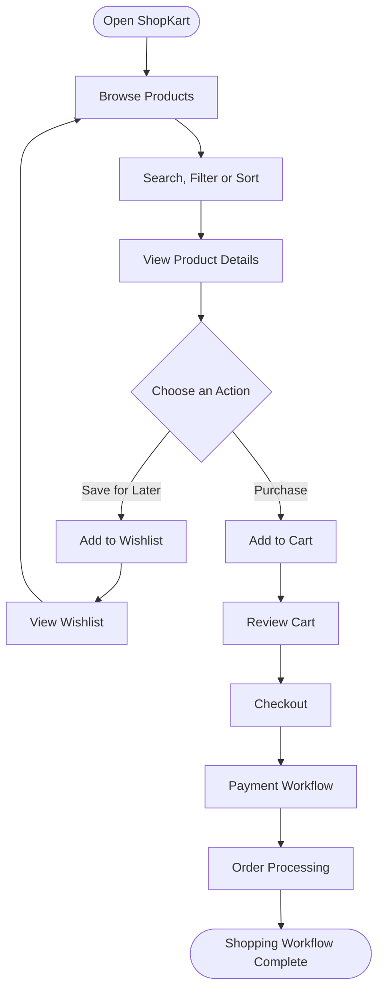
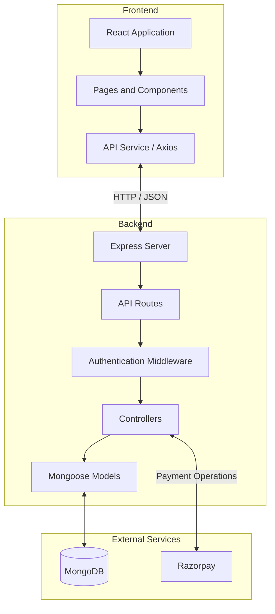

# 🛍️ ShopKart — Full-Stack E-Commerce Platform

\<p align="center">
&#x20; \<strong>A modern e-commerce web application built with the MERN stack.\</strong>
&#x20; \<br />
&#x20; Browse products, manage your wishlist and shopping cart, place orders, and experience an end-to-end online shopping workflow.
\</p>

\<p align="center">
&#x20; \
&#x20; \
&#x20; \
&#x20; \
&#x20; \
\</p>

\<p align="center">
&#x20; \<a href="[https://github.com/0NYX07/ShopKart](https://github.com/0NYX07/ShopKart)">Repository\</a> •
&#x20; \<a href="[https://github.com/0NYX07/ShopKart/issues](https://github.com/0NYX07/ShopKart/issues)">Report a Bug\</a> •
&#x20; \<a href="[https://github.com/0NYX07/ShopKart/issues](https://github.com/0NYX07/ShopKart/issues)">Request a Feature\</a>
\</p>

---

## 📌 Table of Contents

- [Overview](#-overview)
- [Key Features](#-key-features)
- [Technology Stack](#-technology-stack)
- [How ShopKart Works](#-how-shopkart-works)
- [Application Architecture](#-application-architecture)
- [Project Structure](#-project-structure)
- [Getting Started](#-getting-started)
- [Environment Configuration](#-environment-configuration)
- [API Reference](#-api-reference)
- [Security](#-security)
- [Learning Outcomes](#-learning-outcomes)
- [Future Improvements](#-future-improvements)
- [Author](#-author)
- [License](#-license)

---

## 🚀 Overview

**ShopKart** is a full-stack e-commerce application developed using the **MongoDB, Express.js, React, and Node.js (MERN) stack**.

The project demonstrates how a modern shopping application connects a user-facing frontend to a backend API and a persistent database.

Instead of relying entirely on browser-side state, ShopKart uses a backend to manage important application data, including user accounts and shopping-related information.

The application brings together frontend development, REST API design, database modeling, authentication, and e-commerce workflows in one project.

### 🎯 Project Goals

- Build a complete frontend-backend application.
- Implement user registration and authentication.
- Retrieve and display products dynamically.
- Provide product search, filtering, and sorting.
- Manage persistent wishlists and shopping carts.
- Develop the foundation for checkout, orders, and payment processing.
- Apply practical software engineering principles to a real-world use case.

---

## ✨ Key Features

### 👤 1. User Authentication

- Customer registration and login.
- Password hashing with bcrypt.
- JSON Web Token (JWT)-based authentication.
- Authentication using HTTP-only cookies.
- Retrieval of the currently authenticated customer's profile.
- Logout functionality.

### 🛒 2. Product Catalog

- Browse available products.
- View individual product details.
- Search for products.
- Filter products by category.
- Sort products using supported sorting options.
- Retrieve product information from the backend API.

### ❤️ 3. Persistent Wishlist

- Add products to a wishlist.
- View saved products.
- Remove products from the wishlist.
- Associate saved products with the authenticated customer.
- Use MongoDB references and populated product data to retrieve wishlist items.

### 🧺 4. Shopping Cart

- Add products to the cart.
- Update product quantities.
- Remove products from the cart.
- Maintain cart data through backend endpoints.
- Support quantity and stock validation where implemented.

### 📦 5. Orders and Checkout

ShopKart's e-commerce workflow provides a foundation for checkout and order management, including payment integration.

The exact payment and order behavior depends on the implemented backend routes and configuration.

### 💳 6. Payment Integration

Razorpay integration is part of the project's payment workflow. Payment processing should be verified using Razorpay's test environment before attempting real transactions.

> **Note:** Features such as payment verification, stock reservation, order status transitions, and refund handling should be evaluated against the current implementation rather than assumed to be complete.

---

## 🧰 Technology Stack

| Technology       | Purpose                                       |
| ---------------- | --------------------------------------------- |
| **React**        | Component-based user interface                |
| **Vite**         | Frontend development server and build tooling |
| **React Router** | Client-side navigation                        |
| **Axios**        | HTTP requests to the backend                  |
| **Context API**  | Shared frontend state where implemented       |
| **Node.js**      | JavaScript runtime for the backend            |
| **Express.js**   | REST API and server-side routing              |
| **MongoDB**      | Persistent document database                  |
| **Mongoose**     | Database schemas, models, and queries         |
| **JWT**          | Authentication tokens                         |
| **bcrypt**       | Password hashing                              |
| **Razorpay**     | Payment gateway integration                   |

---

## 🔄 How ShopKart Works

A typical shopping workflow follows this sequence:



### What happens behind the scenes?

1. **React renders the interface.** Components display products, forms, navigation, and shopping-related information.
2. **Axios sends HTTP requests.** The frontend communicates with the Express backend.
3. **Express handles requests.** Routes and controllers validate input and execute application logic.
4. **Mongoose communicates with MongoDB.** Models define how application data is represented and stored.
5. **The backend returns a response.** The frontend uses the response to update the interface.
6. **Authentication protects customer-specific operations.** Authenticated requests use the configured JWT and cookie mechanism.

---

## 🏗️ Application Architecture

ShopKart follows a client-server architecture.



### Architecture Responsibilities

| Layer                    | Responsibility                                    |
| ------------------------ | ------------------------------------------------- |
| **Pages and Components** | Render the interface and handle user interactions |
| **API Service**          | Send requests to backend endpoints                |
| **Routes**               | Map HTTP methods and URLs to handlers             |
| **Middleware**           | Apply authentication and request-processing logic |
| **Controllers**          | Implement application behavior                    |
| **Models**               | Define and query database documents               |
| **MongoDB**              | Persist application data                          |
| **Razorpay**             | Support the configured payment workflow           |

This separation makes the application easier to understand, test, debug, and extend.

---

## 📂 Project Structure

The repository separates the frontend from the backend.

```text
ShopKart/
│
├── backend/
│   ├── controllers/
│   │   ├── customer.controller.js
│   │   ├── product.controller.js
│   │   ├── wishlist.controller.js
│   │   ├── cart.controller.js
│   │   └── order.controller.js
│   │
│   ├── middlewares/
│   │   └── auth.middleware.js
│   │
│   ├── models/
│   │   ├── customer.model.js
│   │   ├── product.model.js
│   │   └── ...
│   │
│   ├── routes/
│   │   └── ...
│   │
│   ├── utils/
│   │   └── generateToken.js
│   │
│   └── index.js
│
├── frontend/
│   ├── src/
│   │   ├── components/
│   │   ├── pages/
│   │   ├── services/
│   │   │   └── api.js
│   │   ├── App.jsx
│   │   └── ...
│   │
│   └── ...
│
├── .gitignore
├── LICENSE
└── README.md
```

*Note: The tree illustrates the repository's main organization. The exact filenames and additional modules may vary as the project evolves.*

### Backend

The backend contains the API, application logic, authentication middleware, and database models.

### Frontend

The frontend contains the React interface, reusable components, pages, navigation, and API communication logic.

---

## ⚙️ Getting Started

Follow these instructions to run ShopKart locally.

### Prerequisites

Install the following tools:

- **Node.js** — preferably a version supported by the project's dependencies.
- **npm** — installed with Node.js.
- **MongoDB** — a local database or MongoDB Atlas connection.
- **Git** — to clone the repository.
- **Razorpay test credentials** — if testing payment functionality.

Check your installations:

```bash
node --version
npm --version
git --version
```

### 1. Clone the Repository

```bash
git clone https://github.com/0NYX07/ShopKart.git
cd ShopKart
```

### 2. Install Backend Dependencies

```bash
cd backend
npm install
```

### 3. Configure Backend Environment Variables

Create a `.env` file in the backend directory and configure the environment variables required by the application.

See [Environment Configuration](#-environment-configuration) below.

### 4. Start the Backend

From the `backend` directory, run the start script defined in its `package.json`.

For example, if the project defines a `dev` script:

```bash
npm run dev
```

If no development script exists, use the start script provided by the project.

The backend's configured port determines the local API address.

### 5. Install Frontend Dependencies

Open a second terminal:

```bash
cd ShopKart/frontend
npm install
```

If your terminal is already inside the repository, use the appropriate relative path.

### 6. Configure the Frontend API URL

Check the frontend API service, typically `frontend/src/services/api.js`, and ensure it points to your local backend.

For a Vite application, the API URL can be configured through a `VITE_` environment variable if the code supports it.

### 7. Start the Frontend

From the `frontend` directory:

```bash
npm run dev
```

Open the local URL printed by Vite in your browser.

**Important:** The exact npm scripts, port numbers, and environment variable names must match the project's current configuration.

---

## 🔐 Environment Configuration

Never commit credentials, access tokens, database passwords, or private keys to GitHub.

The following table describes common configuration values that may be required. Use the exact variable names expected by the current code.

| Variable              | Purpose                             |
| --------------------- | ----------------------------------- |
| `MONGO_URI`           | MongoDB connection string           |
| `PORT`                | Backend server port                 |
| `JWT_SECRET`          | Secret used to sign JWTs            |
| `RAZORPAY_KEY_ID`     | Razorpay API key identifier         |
| `RAZORPAY_KEY_SECRET` | Razorpay API secret                 |
| `VITE_API_URL`        | Frontend API base URL, if supported |

These names are illustrative and are not a guarantee that every variable is read by the current application.

### Example configuration

```dotenv
PORT=5000
MONGO_URI=your_mongodb_connection_string
JWT_SECRET=replace_with_a_long_random_secret

RAZORPAY_KEY_ID=your_razorpay_test_key_id
RAZORPAY_KEY_SECRET=your_razorpay_test_key_secret
```

Only add variables that the application actually uses.

For payment testing, use test credentials. Do not expose secret keys in frontend code or commit them to the repository.

---

## 🔌 API Reference

The following table summarizes the application's documented API routes. Confirm request bodies, response formats, and any additional routes directly in the backend before integrating new clients.

### Authentication and Customers

| Method | Endpoint              | Purpose                       |
| ------ | --------------------- | ----------------------------- |
| `POST` | `/customers/register` | Register a customer           |
| `POST` | `/customers/login`    | Authenticate a customer       |
| `GET`  | `/customers/me`       | Retrieve the current customer |
| `POST` | `/customers/logout`   | Log out a customer            |

### Products

| Method | Endpoint        | Purpose                                                      |
| ------ | --------------- | ------------------------------------------------------------ |
| `GET`  | `/products`     | Retrieve products                                            |
| `GET`  | `/products/:id` | Retrieve a product by ID                                     |
| `POST` | `/products`     | Create a product, subject to the current route configuration |

The product listing supports query parameters documented by the project, including search, category filtering, and sorting.

Example:

```http
GET /products?search=phone&category=Electronics&sort=price
```

Use only query parameter values supported by the backend.

### Wishlist

| Method   | Endpoint               | Purpose                            |
| -------- | ---------------------- | ---------------------------------- |
| `GET`    | `/wishlist`            | Retrieve wishlist items            |
| `POST`   | `/wishlist/:productId` | Add a product to the wishlist      |
| `DELETE` | `/wishlist/:productId` | Remove a product from the wishlist |

### Cart

| Method   | Endpoint           | Purpose                       |
| -------- | ------------------ | ----------------------------- |
| `GET`    | `/cart`            | Retrieve cart contents        |
| `POST`   | `/cart/:productId` | Add a product to the cart     |
| `PATCH`  | `/cart/:productId` | Update a cart item's quantity |
| `DELETE` | `/cart/:productId` | Remove a cart item            |

### Orders and Payments

Order and payment endpoints depend on the current backend implementation. Inspect the order routes and payment controller for the supported operations, required request payloads, and payment verification process.

**API note:** Route prefixes, authentication requirements, and payload schemas should always be checked against the actual source code. The endpoint lists above are a reference, not a substitute for backend validation.

---

## 🛡️ Security

Security is an important part of any application that handles customer accounts and payments.

ShopKart uses or is designed around several relevant security mechanisms:

- **Password hashing:** bcrypt helps avoid storing customer passwords in plaintext.
- **JWT authentication:** tokens can be used to authenticate requests.
- **HTTP-only cookies:** configured cookies reduce direct JavaScript access to authentication tokens.
- **Backend validation:** incoming data should be validated before database operations.
- **Environment variables:** credentials should remain outside version control.
- **Payment verification:** payment status must be verified by the backend rather than trusted solely from the frontend.
- **Database validation:** product IDs, quantities, prices, and stock levels should be checked on the server.

For a production deployment, additional review should cover cookie settings, CORS, rate limiting, input validation, authorization, payment signature verification, and order consistency.

---

## 🧠 Learning Outcomes

ShopKart provides practical experience with full-stack application development.

By exploring this project, developers can learn about:

- Building reusable React components.
- Managing frontend routes and application state.
- Connecting a frontend to a REST API.
- Designing Express routes and controllers.
- Modeling relationships with MongoDB and Mongoose.
- Implementing registration and login flows.
- Handling authentication cookies and JWTs.
- Performing CRUD operations.
- Implementing search, filtering, and sorting.
- Managing persistent wishlist and cart data.
- Understanding checkout and payment integration.
- Organizing a full-stack project into maintainable modules.
- Managing environment variables and version control.

---

## 🔮 Future Improvements

Potential improvements for ShopKart include:

- [ ] Add comprehensive unit and integration tests.
- [ ] Improve server-side validation and consistent API error responses.
- [ ] Add product pagination and advanced filtering.
- [ ] Strengthen cart and inventory consistency during checkout.
- [ ] Verify payment signatures and handle duplicate payment callbacks safely.
- [ ] Add order history and detailed order tracking.
- [ ] Introduce product reviews and ratings.
- [ ] Improve accessibility and mobile responsiveness.
- [ ] Add structured logging and application monitoring.
- [ ] Implement CI checks and automated deployment.
- [ ] Deploy the frontend and backend with secure production configuration.

These are possible next steps, not claims that the features are already implemented.

---

## 🤝 Contributing

Contributions, bug reports, and suggestions are welcome.

1. Fork the repository.
2. Create a feature branch.
3. Make your changes.
4. Test the relevant functionality.
5. Submit a pull request describing the changes.

For bugs or feature requests, use the [GitHub Issues](https://github.com/0NYX07/ShopKart/issues) page.

---

## 👨‍💻 Author

**Krishna**

- GitHub: [@0NYX07](https://github.com/0NYX07)
- Project: [ShopKart](https://github.com/0NYX07/ShopKart)

---

\<p align="center">
&#x20; \<strong>ShopKart\</strong>
&#x20; \<br />
&#x20; Built with React, Node.js, Express, and MongoDB.
&#x20; \<br />\<br />
&#x20; ⭐ If you find this project useful, consider giving the repository a star!
\</p>
